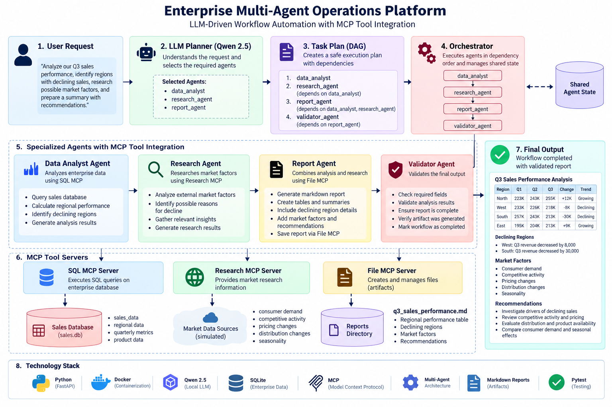

# Enterprise Multi-Agent Operations Platform

An enterprise-oriented multi-agent workflow platform that uses an LLM
planner, specialized AI agents, Model Context Protocol (MCP) tool
servers, shared workflow state, validation, and automated report
generation.

The platform accepts a natural-language business request, determines
which specialized agents are required, executes them according to a
dependency-aware workflow, validates the output, and produces a final
business artifact.

------------------------------------------------------------------------

## Architecture



### High-Level Workflow

``` text
User Request
     |
     v
LLM Planner
(Qwen 2.5)
     |
     v
Task Plan
     |
     v
Orchestrator
     |
     +-------------------+
     |                   |
     v                   v
Data Analyst       Research Agent
     |                   |
     v                   v
 SQL MCP           Research MCP
     |                   |
     +---------+---------+
               |
               v
          Report Agent
               |
               v
            File MCP
               |
               v
         Validator Agent
               |
               v
         Validated Output
```

------------------------------------------------------------------------

## Overview

Example business request:

> Analyze our Q3 sales performance, identify the regions with declining
> sales, research possible market factors, and prepare a summary with
> recommendations.

The platform converts this natural-language request into an executable
multi-agent workflow.

The LLM planner identifies the specialized capabilities required, while
the application constructs and validates the execution dependencies.

### Key Features

-   LLM-driven task planning
-   Multi-agent workflow orchestration
-   Dependency-aware agent execution
-   Specialized agents for different business tasks
-   Model Context Protocol (MCP) tool integration
-   SQL database access through MCP
-   Research capability through MCP
-   File generation through MCP
-   Shared workflow state
-   Result validation
-   Local LLM execution
-   FastAPI REST API
-   Dockerized deployment
-   Automated testing with Pytest
-   Markdown business report generation

------------------------------------------------------------------------

## Agent Architecture

### 1. LLM Planner

The planner uses a local Qwen 2.5 model to interpret the user's request
and identify the specialized agents required.

Available agents:

``` text
data_analyst
research_agent
report_agent
validator_agent
```

The LLM identifies the required agents, while the application constructs
and validates the dependency graph deterministically.

This prevents the LLM from directly creating unsafe or circular
execution dependencies.


### 2. Orchestrator

The orchestrator is responsible for:

-   Creating workflow state
-   Executing the generated task plan
-   Checking dependencies
-   Invoking specialized agents
-   Tracking execution status
-   Handling workflow failures
-   Returning the final workflow state

Example execution order:

``` text
data_analyst
      |
      v
research_agent
      |
      v
report_agent
      |
      v
validator_agent
```

The orchestrator verifies that an agent's dependencies have completed
before executing that agent.

### 3. Specialized Agents

#### Data Analyst Agent

Responsible for numerical and database analysis.

Responsibilities:

-   Query enterprise sales data
-   Calculate quarterly revenue
-   Compare regional performance
-   Identify declining regions
-   Calculate quarter-over-quarter changes
-   Produce structured analysis results

The Data Analyst Agent accesses the sales database through the SQL MCP
server.

#### Research Agent

Responsible for gathering relevant market factors.

The current MVP uses controlled sample research data exposed through the
Research MCP server.

Example market factors:

-   Consumer demand
-   Competitive activity
-   Pricing changes
-   Distribution changes
-   Seasonality

The current implementation intentionally uses controlled sample research
data rather than claiming that these factors are proven causes of the
sales decline.

#### Report Agent

The Report Agent combines the outputs from the Data Analyst and Research
Agents.

It produces:

-   Business summary
-   Regional performance table
-   Declining-region analysis
-   Market factors
-   Recommendations
-   Markdown report artifact

The report is created through the File MCP server.

#### Validator Agent

The Validator Agent runs after report generation.

It checks:

-   Data analysis exists
-   Research results exist
-   Report exists
-   Required report fields exist
-   Workflow errors are surfaced

The workflow is considered successfully validated only when these checks
pass.

------------------------------------------------------------------------

## MCP Architecture

The platform separates agent reasoning from tool execution using Model
Context Protocol.

``` text
                    MCP Layer
                       |
       +---------------+---------------+
       |               |               |
       v               v               v
   SQL MCP        Research MCP      File MCP
       |               |               |
       v               v               v
 sales.db        Research Data     reports/
```

### SQL MCP Server

Provides controlled read-only SQL access to the sales database.

Tool:

``` text
execute_sql(query)
```

Only `SELECT` queries are permitted.

This allows the Data Analyst Agent to access enterprise-style data
without embedding database execution logic directly inside the agent.

### Research MCP Server

Provides structured research information to the Research Agent.

Tool:

``` text
research_topic(topic)
```

The current implementation provides controlled sample market research
data.

### File MCP Server

Provides controlled report generation.

Tool:

``` text
create_report(filename, content)
```

The current implementation allows Markdown report files to be created
inside the project's reports directory.

------------------------------------------------------------------------

## Shared Agent State

Agents communicate through a shared `AgentState` object rather than
directly invoking one another.

The shared state contains:

``` text
AgentState
├── task
├── status
├── data_analysis
├── research_results
├── report
├── validation
└── errors
```

This allows downstream agents to consume results produced by upstream
agents while keeping each agent's responsibility separate.

------------------------------------------------------------------------

## Workflow Planning and Dependency Safety

A key design decision is separating LLM agent selection from workflow
dependency construction.

The LLM determines which agents are required:

``` text
LLM
 |
 | selects agents
 v
Application
 |
 | constructs dependencies
 v
Validated execution plan
```

The application then constructs the dependency graph deterministically.

For example:

``` text
data_analyst
      |
      v
research_agent
      |
      v
report_agent
      |
      v
validator_agent
```

The planner also validates:

-   Allowed agent names
-   Missing dependencies
-   Self-dependencies
-   Circular dependencies

This provides greater control over workflow execution than allowing the
LLM to directly define the complete execution graph.

------------------------------------------------------------------------

## Example Result

### Regional Sales Performance

  Region     Q1 Revenue   Q2 Revenue   Q3 Revenue   Q3 vs Q2 Trend
  -------- ------------ ------------ ------------ ---------- -----------
  North         223,000      243,000      255,000    +12,000 Growing
  West          233,000      226,000      218,000     -8,000 Declining
  South         257,000      243,000      213,000    -30,000 Declining
  East          195,000      204,000      213,000     +9,000 Growing

### Declining Regions

-   **West**
    -   Q2 Revenue: 226,000
    -   Q3 Revenue: 218,000
    -   Change: -8,000
-   **South**
    -   Q2 Revenue: 243,000
    -   Q3 Revenue: 213,000
    -   Change: -30,000

### Market Factors

-   Consumer demand
-   Competitive activity
-   Pricing changes
-   Distribution changes
-   Seasonality

### Recommendations

-   Investigate the drivers of declining sales in the identified
    regions.
-   Review competitive activity and pricing changes in declining
    regions.
-   Evaluate distribution and product availability in declining regions.
-   Compare consumer demand and seasonal effects across regions.

------------------------------------------------------------------------

## Generated Artifact

The Report Agent creates:

``` text
reports/q3_sales_performance.md
```

The generated report contains:

-   Regional sales performance
-   Quarterly revenue comparison
-   Declining regions
-   Market factors
-   Recommendations

Generated reports are intentionally excluded from version control.

------------------------------------------------------------------------

## Technology Stack

  Technology                  Purpose
  --------------------------- --------------------------------------
  Python                      Application and agent implementation
  FastAPI                     REST API
  Qwen 2.5 0.5B               Local LLM planner
  Hugging Face Transformers   Local model execution
  MCP                         Agent-tool integration
  SQLite                      Sample enterprise sales database
  Pydantic                    Data models and validation
  Docker                      Containerization
  Pytest                      Automated testing
  Markdown                    Generated business reports

------------------------------------------------------------------------

## Local Setup

Follow the steps below to run the project locally.

git clone <repo-url>
cd enterprise-multi-agent-platform
python3 -m venv .venv && source .venv/bin/activate
pip install -r requirements.txt
python -m app.core.database
uvicorn app.main:app --reload

------------------------------------------------------------------------

## API

### Health Check

``` text
GET /health
```

Example:

``` bash
curl http://localhost:8000/health
```

### Execute Workflow

``` text
POST /api/v1/workflows
```

Request:

``` json
{
  "task": "Analyze our Q3 sales performance, identify the regions with declining sales, research possible market factors, and prepare a summary with recommendations."
}
```

------------------------------------------------------------------------

## Docker

Build and start the application:

``` powershell
docker compose up -d --build
```

Check the container:

``` powershell
docker compose ps
```

The application exposes:

``` text
http://localhost:8000
```

Test the health endpoint:

``` powershell
Invoke-RestMethod http://localhost:8000/health
```

Execute the workflow:

``` powershell
Invoke-RestMethod `
  -Uri http://localhost:8000/api/v1/workflows `
  -Method POST `
  -ContentType "application/json" `
  -Body '{"task":"Analyze our Q3 sales performance, identify the regions with declining sales, research possible market factors, and prepare a summary with recommendations."}'
```

Generated reports are mounted to:

``` text
./reports/
```

------------------------------------------------------------------------

## Design Decisions

### Why use an LLM planner?

Enterprise requests can require different combinations of specialized
capabilities.

The planner allows the system to interpret a natural-language request
and identify which agents are required instead of relying on a single
hard-coded workflow.

### Why construct dependencies deterministically?

LLMs can generate malformed or circular dependency graphs.

Therefore, the system separates agent selection from dependency
construction:

``` text
LLM
 |
 | selects required agents
 v
Application
 |
 | constructs and validates dependencies
 v
Execution Plan
```

This provides more predictable workflow execution.

### Why use MCP?

MCP provides a standardized interface between agents and external
capabilities.

Instead of embedding database, research, and file-handling logic
directly inside every agent:

``` text
Agent
  |
  v
MCP Tool
  |
  v
External Capability
```

Tools can remain independently maintainable and reusable.

### Why use a local LLM?

The project uses a local Qwen model so that the complete workflow can be
developed and tested without requiring an external model API.

The lightweight model is sufficient for the planner's current task of
identifying required agents and returning structured JSON.
